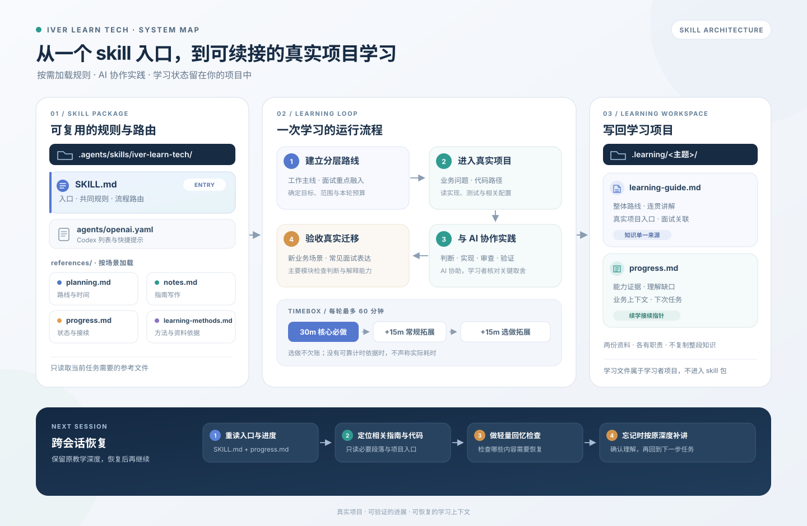

# Iver Learn Tech

面向已有编程基础者的技术学习 skill。以真实业务和项目代码为主线，与 AI 协作学习新技术；把常见面试重点融入相关主题，并用有边界的学习计划、可读指南和接续进度减少遗忘与重复。



## 快速开始

安装或在本项目目录使用后，直接说明想学什么、已有基础、用途和可用时间。缺少会影响计划的信息时，AI 会一次问一个问题，给出推荐与理由；信息足够就开始。

```text
使用 $iver-learn-tech 带我系统学习 Redis。我有 Java 基础，想知道它在工作中的常见用途，也要能聊面试高频点。
请先给我分层路线，工作实践为主；每轮先做约 30 分钟核心内容，再视情况拓展到 45 分钟，最多 60 分钟。阅读真实项目中的缓存流程，再开始第一项实践。
```

面试方向也可以直接说明：

```text
使用 $iver-learn-tech 帮我准备 Redis 面试。我用过基础命令，
希望先知道完整的高频主题路线，再把有限时间放在原理、边界和常见追问上；每轮最多 60 分钟。
```

技术地图分为面试常见、工作常用和进阶认知，不代表每项都要学到同样深度。默认工作场景为主线，重合面试点随主题学习，高频但不重合的考点简要补充。时间是计划约束，不是掌握效果的保证；整体投入会估算并按实际进度调整。

## 安装与调用

完整 skill 文件夹位于 [`.agents/skills/iver-learn-tech`](.agents/skills/iver-learn-tech)，包含 `SKILL.md`、`references/` 和 `agents/`，复制或安装时保留整个文件夹。

- **当前项目使用**：在本项目目录开展学习，通过 `$iver-learn-tech` 调用。
- **其他项目使用**：将整个 `iver-learn-tech` 文件夹放入目标项目的 `.agents/skills/`，或放入 Codex 的用户级技能目录 `~/.agents/skills/`。
- **从 GitHub 安装**：让 `$skill-installer` 从 [`yfandragon/iver-learn-tech`](https://github.com/yfandragon/iver-learn-tech) 仓库安装 `.agents/skills/iver-learn-tech` 这个路径。

本 skill 自带计划阶段的 grill 规则，无需另外安装 grilling。Codex 支持本地技能发现及从其他仓库安装；运行环境与最新路径以 [OpenAI 官方说明](https://learn.chatgpt.com/docs/build-skills) 为准。更新未出现在列表时，可重启 Codex。

## 一轮学习怎样进行

1. 先建立分层路线，再根据现实用途、已有基础和时间安排本轮；不把整项技术压缩成一个小 demo。
2. 阅读真实业务场景和相关项目代码，追踪一个可理解的功能流程；尽早做小实验或验证。若你没有提供项目路径，skill 会默认挑选相关的真实公开代码库作只读参考，说明选择依据，你也可以随时换项目。
3. AI 可以比较、解释、生成和修改实现；学习者练习判断适用性、引导 AI、审查关键取舍并验证结果，不要求脱离 AI 手写所有代码。
4. 每轮先安排约 30 分钟核心内容，按需拓展到约 45 分钟，最多 60 分钟。额外内容是选做，不形成欠账。
5. 把整体路线与连贯讲解写进学习指南，把能力证据和下次接续上下文写进进度；主要模块用面试表达和新业务场景迁移检验。

| 学习侧重 | 阶段成果与验收重点 |
| --- | --- |
| 工作应用主线 | 用新业务场景判断技术是否适用，能和 AI 形成实现方案、核查关键结果并解释取舍。 |
| 面试重点 | 能说明高频主题的原理、适用边界和权衡，接住常见追问，不要求背标准答案。 |
| 仅面试准备 | 用户明确以面试为主时，再扩大面试主题范围；仍控制投入与收束条件。 |

## 会保存哪些学习文档

默认保存到你正在学习的项目中；已有目录和笔记会优先沿用。

```text
.learning/<技术主题>/
├── learning-guide.md  # 整体路线、连贯讲解、真实项目入口与相关面试点
└── progress.md        # 能力证据、理解缺口、业务上下文与下次接续方式
```

指南把路线与主题笔记合在一处，按主题增量更新，不另写面试题集。进度保存项目版本和代码入口、学习者理解到哪里、仍需补讲什么、下次最小任务。新会话只读取相关段落，不重复加载整份指南；若忘记，会按原有深度补讲后再继续。

实验代码、配置与作品按任务需要保存到项目里。学习文档属于各自的学习项目；仓库根目录的 README 是 skill 使用说明。

## 继续学习、回看笔记与调整计划

换会话后，提供学习目录或打开对应项目：

```text
使用 $iver-learn-tech 继续上次 Redis 学习，先读 .learning/redis/progress.md 和指南里关联的部分，
恢复上次的业务场景与讲解位置，再做一个轻量回忆检查。如果我忘了，请按上次的讲解深度补讲后再继续。我今天有半小时。
```

方向或时间改变时直接说明：

```text
这轮改为面试为主，保留已有实验和笔记，调整剩余计划；今天只剩十分钟。
```

AI 会沿用有效信息和已有证据，检查新目标的差距。关键取舍需要澄清时再追问，避免每次重做完整访谈。

## 资料与方法依据

AI 根据整体路线和本轮目标组织学习，优先从真实项目代码、测试与一手资料核对关键行为；教材或课程用于补充理解缺口。正常示例跑通不能证明所有边界，读过指南也不自动代表已经掌握。

- [正式 skill](.agents/skills/iver-learn-tech/SKILL.md)
- [整体路线与时间规划规范](.agents/skills/iver-learn-tech/references/planning.md)
- [学习指南写作规范](.agents/skills/iver-learn-tech/references/notes.md)
- [进度记录规范](.agents/skills/iver-learn-tech/references/progress.md)
- [学习方法与一手来源](.agents/skills/iver-learn-tech/references/learning-methods.md)
- [当前设计说明](docs/skill-design.md)

方法依据区分研究、实践者经验和设计推导。这套组合仍需实际使用验证，不承诺固定小时数内完整掌握。没有文件工具时，会输出可保存的文档内容，并说明尚未写入文件。
